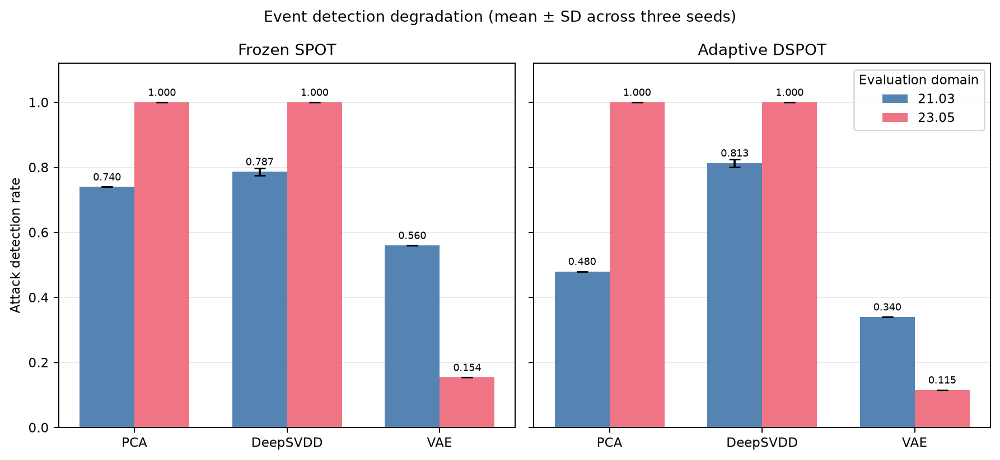
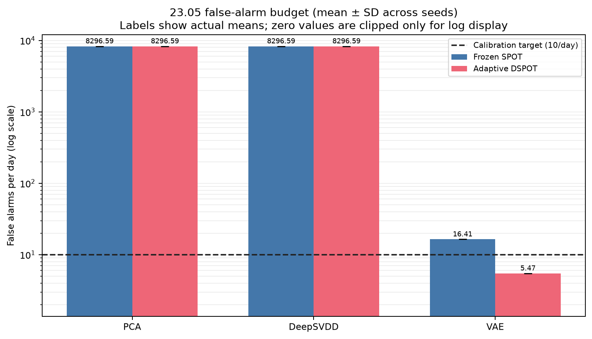

# Zero-Day Detection under HAI Plant-Version Shift

**Source-only representations; frozen SPOT versus adaptive DSPOT decisions**

Hongbin Zhang and Zeren Wang | Project Group 88 | SSY340 Deep Machine Learning

## Setup

1,608,008 real 1-Hz rows | 59 shared tags filtered to 41 source-nonconstant tags | 102 attacks total | 52 attacks in 23.05 | seeds 11, 23, 37.

PCA, DeepSVDD, and standard convolutional VAE; causal 60 s windows / 10 s evaluation stride / max sensor fusion. Normal 21.03-only training and EVT calibration; no point adjustment; eTaPR theta_p=0.5, theta_r=0.1 (SAC 2022).

## Key Results

| Model | 23.05 event F | 23.05 event A | Gain | Recovery ROM | PR-AUC |
| --- | --- | --- | --- | --- | --- |
| PCA | 1.000 | 1.000 | 0.000 | n/a | 0.110 |
| DeepSVDD | 1.000 | 1.000 | 0.000 | n/a | 0.092 |
| VAE | 0.154 | 0.115 | -0.038 | -0.095 | 0.232 |

F = frozen SPOT; A = adaptive DSPOT; ROM = ratio of mean gain to mean loss. Values are three-seed means.

## Findings

- VAE achieved the highest mean 23.05 PR-AUC (0.232 ± 0.000). Frozen and adaptive PR-AUC are identical because both arms threshold the same continuous scores.
- For VAE, frozen event recall moved from 0.560 on 21.03 to 0.154 on 23.05; DSPOT changed cross-domain recall to 0.115 (gain -0.038; recovery ROM -0.095) and false alarms from 16.41 to 5.47 per day.
- The highest raw frozen 23.05 event recall belonged to PCA and DeepSVDD (1.000 ± 0.000); the highest raw adaptive recall belonged to PCA and DeepSVDD (1.000 ± 0.000). Raw recall is not a stand-alone measure of useful detection.
- PCA and DeepSVDD had the largest signed mean DSPOT event-detection gain (+0.000; ratio-of-means recovery undefined). A positive gain is recovery, whereas a negative gain is an additional loss.
- Observed 23.05 false alarms spanned 5.470–8296.588 per day across runs; the source-normal calibration target was 10 per day. Near-continuous-alarm failure screen (at least 99.9% event recall and at least 90% normal-window false alarms): PCA / frozen (mean recall 1.000, mean FA/day 8296.59, normal-window alarm fraction 96.0%); PCA / adaptive (mean recall 1.000, mean FA/day 8296.59, normal-window alarm fraction 96.0%); DeepSVDD / frozen (mean recall 1.000, mean FA/day 8296.59, normal-window alarm fraction 96.0%); DeepSVDD / adaptive (mean recall 1.000, mean FA/day 8296.59, normal-window alarm fraction 96.0%). These high-recall conditions are alarm-collapse failures, not evidence of useful detection or DSPOT recovery.

## Interpretation

DSPOT changes the decision layer, not the representation. Frozen/adaptive PR-AUC is identical because scores are shared. Attribution coverage and eligibility use the 41-tag source-nonconstant schema; attacks with no retained documented target are excluded from hit denominators, never counted as attribution failures.

**Selected references:** HAI (CSET 2020, 2021); Deep SVDD (ICML 2018); Rethinking Assumptions in Deep Anomaly Detection (2020); SPOT (KDD 2017); TaPR (CIKM 2019); eTaPR (SAC 2022); Kim et al. (AAAI 2022).
